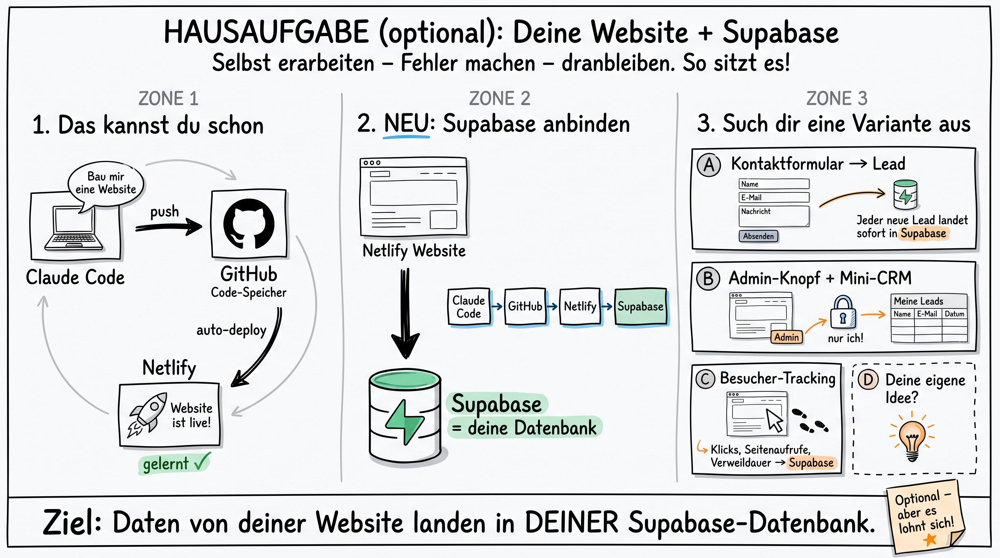

# Whiteboard-Skill für Claude Code

Claude Code zeichnet dir auf Zuruf Whiteboard-Skizzen, Ablaufdiagramme und Tafelbilder – mit deutscher Beschriftung. Im Hintergrund arbeitet Googles Bildmodell Gemini „Nano Banana Pro“.

Du sagst einfach in Claude Code: *„Zeichne mir als Whiteboard, wie mein Kontaktformular mit Supabase zusammenhängt.“*



## Was du brauchst

- Claude Code
- Python 3 (auf dem Mac vorinstalliert)
- Einen eigenen Gemini-API-Key von Google

## Einrichtung in 4 Schritten

### 1. API-Key holen

Auf [aistudio.google.com/apikey](https://aistudio.google.com/apikey) mit deinem Google-Konto anmelden und „Create API key“ klicken. Für das Pro-Bildmodell muss in Google Cloud eine Abrechnung hinterlegt sein. Ein Bild kostet je nach Größe nur wenige Cent.

### 2. Key ablegen

Im Terminal (den Platzhalter durch deinen Key ersetzen):

```bash
echo 'GEMINI_API_KEY=DEIN_KEY_HIER' > ~/.whiteboard.env && chmod 600 ~/.whiteboard.env
```

Der Key bleibt nur auf deinem Rechner. Niemals in ein Repository hochladen.

### 3. Repository holen und Befehl einrichten

```bash
git clone https://github.com/quualle/whiteboard-skill.git ~/whiteboard-skill
mkdir -p ~/.local/bin && ln -sf ~/whiteboard-skill/whiteboard.py ~/.local/bin/whiteboard
```

Prüfen mit `whiteboard --help`. Wenn „command not found“ kommt, fehlt `~/.local/bin` im Suchpfad:

```bash
echo 'export PATH="$HOME/.local/bin:$PATH"' >> ~/.zshrc && source ~/.zshrc
```

### 4. Skill bei Claude Code anmelden

```bash
mkdir -p ~/.claude/skills && cp -r ~/whiteboard-skill/skill/whiteboard ~/.claude/skills/
```

Claude Code neu starten. Ab jetzt reicht: *„Mal mir das als Whiteboard.“*

> **Tipp:** Du kannst auch einfach Claude Code bitten: *„Richte mir den Whiteboard-Skill aus https://github.com/quualle/whiteboard-skill ein.“* Den API-Key trägst du dann selbst ein.

## Direkt im Terminal nutzen

```bash
whiteboard "Drei Boxen: Website -> Kontaktformular -> Supabase-Datenbank"
whiteboard --aspect 16:9 --size 2K "Querformat-Tafelbild mit ..."
whiteboard --fast "schnelle Skizze"
```

Die Bilder landen in `~/Pictures/whiteboards/`. Einen anderen Ordner legst du mit `--out` oder der Variable `WHITEBOARD_OUT` fest.

Im Ordner `beispiele/` liegt der vollständige Prompt zum Beispielbild oben. So siehst du, wie konkret ein guter Prompt sein darf.

---

Bereitgestellt von [Synclaro](https://synclaro.de) für die Teilnehmer des KI-Marketing-Moduls.
